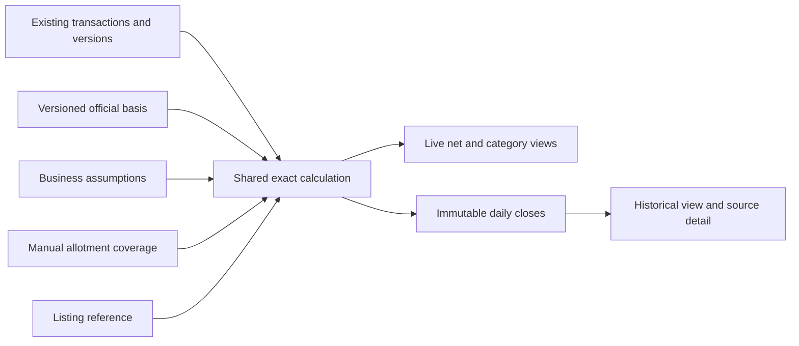

# IPO dashboard database and API design

Status: assumptions/history API and source-fact snapshots are implemented
in migration 015 and the existing Go backend, tested in disposable databases. They
are installed in the existing local/hosted databases; API rollout is pending. Remaining
dashboard/reconciliation/closing/listing contracts are proposed.
The [dashboard requirements](IPO_POSITION_REPORTING.md) own product behaviour;
the [rate guidance](PROJECT_VISION.md#application-rate-guidance-agreed-implementation-pending)
owns pricing formulas. This document defines how to deliver those requirements
through the existing Go/PostgreSQL application.



## Boundaries and reuse

- Reuse `businesses`, `business_memberships`, shared `ipos`/`form_types`,
  `transactions`, `transaction_versions` and catalogue observations. Do not add a
  second transaction ledger, duplicate staff roles or a parallel IPO catalogue.
- Keep signed quantity as direction: positive Buy, negative Sell. Preserve the
  generated transaction amount `round(quantity * rate, 2)` and its existing API.
  An active `confirmed` transaction is not proof of successful allotment.
- Financial values and quantities use exact decimals and API strings. Server
  calculations never use binary floating point for costs, rates or probabilities.
- Shared forecasts, GMP and the Subject 2 factor belong to a business and IPO.
  Admins write them; cashiers read/use them. Caller identity comes from the session.
- Payments, collections and after-listing cash settlement remain outside scope.
  CE/PE payout rules are not yet agreed: preserve those transactions but identify
  their valuation contribution as unsupported instead of silently dropping it.

## Calculation contract

For a supported application category, resolve a validated basis containing
`shares_per_successful_application` and `applications_at_1x`. The user's input is
`expected_applications`. Compute the exact ratio without rounding it first:

```text
p = applications_at_1x / expected_applications
Subject 1 forecast shares = signed application quantity * p * shares per success
Subject 1 premium cost = saved signed transaction amount
Subject 2 forecast shares = signed application quantity * p * shares per success
Subject 2 expected premium cost = signed application quantity * agreed rate * p
Already allotted shares = signed application quantity * confirmed shares per application
Already allotted premium cost = saved signed transaction amount
Direct SHARES contribution = signed share quantity, at the saved premium amount
```

Subject 2 expected cost is not its recorded face amount and is not a payment entry.
When actual successful quantities are supplied, its actual cost is those signed
successful quantities times their original rates. Do not alter the transaction.

Application capacity and successful share quantity are not interchangeable with
shares offered, shares applied for or a minimum application size. Use the ratio
model only where counts/units and allotment rules support it and `0 <= p <= 1`.
Store a valid positive forecast count even if the selected simple model cannot
value it; report `allotment_model_unavailable` rather than inventing a probability.
Zero/missing denominators, missing category basis and unsupported issue rules keep
the affected result unavailable. Do not silently cap or reinterpret the forecast.

Retail and Retail 199 remain separate trading buckets but normally share one
published retail allocation pool and one expected retail application count. Their
share-conversion basis is resolved separately. The initial independent forecast
pools are Retail, SHNI, BHNI and, only where offered, Shareholder; the Retail 199 input displays its
shared Retail forecast, not a duplicate editable assumption.

Shareholder is a supported global form type, not a mandatory allocation category
for every IPO. The basis and read APIs expose its per-IPO `availability` as
`available`, `not_offered` or `unknown`, with source evidence/time. Only validated
allocation evidence can establish `not_offered`; an empty reservations array,
failed enrichment or missing quota row alone leaves availability unknown.

For `not_offered`, the current assumptions use a null Shareholder forecast; it is
not a missing required input. The dashboard omits its normal forecast/pricing row
and new-entry choice. Assumption writes reject a new non-null Shareholder forecast
for that confirmed state. Existing Shareholder transactions, former forecasts and
daily closes remain readable: expose their source inconsistency rather than
deleting them or silently omitting their financial contribution. If availability
is unknown and no Shareholder exposure exists, do not force a forecast or block
unrelated categories. Relevant existing exposure retains its unknown-basis reason.

Aggregate contributions once per active transaction/source version. Cancelled
transactions do not contribute to current results. After reconciliation, replace
covered share estimates with the supplied confirmed net shares; add uncovered
trades once. A reconciliation does not add its share count on top of covered
forecasts or confirmed purchases.

```text
Net shares = confirmed net shares + remaining forecast net shares
Net premium cost = sum of signed application cost contributions and share premium amounts
Book result = net shares * valuation premium - net premium cost
Break-even premium = net premium cost / net shares, only for nonzero net shares
```

Net premium cost includes negative Sell amounts naturally; do not subtract them
twice. Buy/sell weighted averages are separate measures using their own quantity
and amount totals. Break-even is not a FIFO/LIFO realized cost-basis calculation.
Do not claim realized matched-trade profit without a defined matching method.

Use the agreed whole-rupee rounding for rate suggestions. Retain exact rational/
decimal intermediates for probability and expected shares/costs; publish share and
rate measures to six decimal places and amounts to two. Build summary and detail
from the same published bucket measures so their totals reconcile. Whole-share
display rounding must not become an allotment or payment instruction.

For complete inputs, `profit_loss_basis` is `forecast` before confirmation or
`listing` after confirmed positions/costs and the listing reference are available.
An aggregate manual share count alone does not identify successful Subject 2
applications or their differently agreed rates. Accept that share confirmation;
keep actual cost/result unavailable until sufficient outcomes exist. An estimate
using forecast costs may be displayed separately as `mixed_confirmed_and_forecast`,
with that label. Never require a manual bank-payment amount to fill this gap.

If any contributing nonzero bucket lacks a required input, the complete IPO
measure is null with reasons. Return separately labelled known subtotals; do not
return a healthy zero or present that subtotal as the whole book. Empty buckets
need no forecast and contribute a real zero. Negative GMP/rates keep their sign.
Completeness is measure-specific: a known linear share position can still be shown
when CE/PE valuation is unsupported, but the entire book's profit cannot be called
complete. Label that position's linear-instrument scope; do not imply that it
measures option exposure.

## Proposed additive storage

Use the existing `ipo_pos` schema. Tables 1 and 2 are implemented in migration 015;
tables 3 through 6 remain proposed. Business-owned rows carry `business_id` and `ipo_id`; use
composite ownership keys and session-derived actors. Every revision is append-only.

### 1. `ipo_dashboard_assumption_versions`

One complete business/IPO assumption revision per write:

| Column | Proposed representation |
|---|---|
| `business_id`, `ipo_id`, `version` | Composite primary key; positive increasing integer version |
| `gmp` | Nullable signed `numeric(18,6)` in INR per share |
| `subject2_pricing_factor` | `numeric(9,6)`, default 0.8; initial control range 0 through 1 inclusive |
| `retail_expected_applications`, `shni_expected_applications`, `bhni_expected_applications`, `shareholder_expected_applications` | Nullable numeric counts constrained to positive integers below 1e24; unscaled numeric prevents silent fractional rounding |
| `recorded_at` | Server database timestamp; no client backdating |
| `changed_by_user_id`, `change_reason` | Active business-admin membership reference and nonempty reason |

There is no separate mutable settings table. Latest version is the current state;
older versions provide GMP/forecast history. No stored row means API version 0,
unknown GMP/counts and a displayed default factor of 0.8; a GET does not insert it.
Null means unknown or explicitly not applicable as identified by category
availability, not zero or an inherited value from another business. In particular,
the nullable Shareholder field does not make shareholder eligibility universal.

Serialize writes for the business/IPO using a transaction-scoped lock and compare
`expected_version`. Append the complete new version atomically. Do not implement
an unprotected `MAX(version)+1`. Require finite values and reject excess precision
or out-of-range counts/factors before PostgreSQL can silently round them.

### 2. `ipo_dashboard_basis_versions`

The initial implementation stores immutable `snapshot` data and typed IPO/version/
recorded-at fields and Shareholder availability. It captures supported public terms,
reservations and subscriptions, excluding volatile fetch times from fact equality.
The model capacities/conversions and confirmed issue/first-trade fields described
below still require verified collection and calculation support.

Shared immutable snapshots of source-owned calculation facts, keyed by
`(ipo_id, version)`: server `recorded_at`, provider observation times, source/import
references, base lot size, price basis, nullable confirmed final issue price,
nullable NSE/BSE first-trade price/time pairs, and a validated `category_basis`
snapshot. Each category basis identifies availability, its pool, units, capacity,
share conversion, supported model and provenance, or explicitly records why it is
unavailable. Keep source availability separate from an incomplete forecast/model.

Existing catalogue tables remain the current operational source. This table
preserves the exact inputs needed to reproduce prior calculations; its JSON is
frozen evidence, not a replacement for relational current catalogue fields or
business forecasts. Keep decimals typed or canonical decimal strings in snapshots.
The trusted importer appends when effective facts change, after validating/merging
the observation without erasing valid fields on partial failure. Compare with the
latest snapshot, not a global unique hash: facts can change A to B and back to A.

Do not backfill old facts from today's catalogue. Before source history collection
starts, historical source-dependent measures may be unavailable. Preserve that
limitation in API output. Extend source parsers only after verifying a first-trade
field/record; the existing 30-minute schedule is not itself a listing-price feed.

### 3. `ipo_allotment_revisions`

Immutable manual share reconciliation: `(business_id, ipo_id, version)`, signed
`confirmed_net_shares numeric(24,6)`, transaction occurrence cutoff `through`,
server `recorded_at`, actor and reason. Zero confirmed net shares is valid. An
optional category split is accepted only if it sums exactly to the aggregate.
Without that split, show confirmed shares as unassigned rather than fabricating
category quantities. GMP and expected-application inputs are not overwritten.
Also store the manual POST's idempotency key and canonical request hash, unique
within the business/IPO reconciliation route, with the creating actor for replay
validation. These do not belong in `manual_transaction_requests`, which references
actual transactions.

The covered book comprises the selected IPO's active application and direct-share
transactions visible to the reconciliation transaction through the cutoff. CE/PE
are outside its linear share-count coverage and remain separately flagged.

### 4. `ipo_allotment_coverage`

For each reconciliation revision, store the exact covered transaction ID/version,
with optional signed `successful_application_quantity` for Subject 2 outcomes.
Use a unique transaction per reconciliation and a composite foreign key to
`transaction_versions(business_id,id,version)`. A database guard additionally
checks that the transaction IPO matches the reconciliation IPO.

Outcome zero means unsuccessful, null means unknown; require a matching direction
and absolute successful quantity no larger than the application quantity. The
server selects coverage; clients cannot submit a cross-business manifest. These
are links/outcomes, not copied editable trades. A later transaction/version not in
the coverage is not silently considered reconciled. Editing/cancelling a covered
trade marks the current reconciliation as needing review; do not add the entire
edited trade again or change historical confirmed shares invisibly.

### 5. `ipo_listing_reference_versions`

Business/IPO revision containing positive final issue price, positive first-trade
price, `exchange` NSE/BSE, first-trade timestamp, source kind automatic/manual,
nullable shared basis version, actor/job provenance, recorded time and reason.
Persist the confirmed values actually used, not a floating link to today's quote.

Automatic selection uses NSE first and BSE only when NSE is unavailable/not
applicable; BSE trading earlier does not override NSE. Manual entry follows the
same reference rule and requires an admin and reason. Do not use last-traded price,
GMP, indicative price or an unconfirmed upper band as the final reference. Both
prices are positive; their difference can be negative. A confirmed reference is
changed only by an attributed new revision, not a silent later-source refresh.
Automatic writes carry trusted job provenance rather than impersonating an admin.
Manual revisions store route-scoped idempotency keys, canonical hashes and actor
identity like reconciliations. Automatic references deduplicate by source basis
version under the book write lock. Do not reuse the transaction-request table for
these writes or allow clients to forge automatic provenance.

### 6. `ipo_daily_closes`

One immutable original row per `(business_id, ipo_id, close_date)` in Asia/Kolkata:
UTC cutoff, server capture time, calculation version, selected assumption/basis/
reconciliation/listing revision references, completeness/reasons, and validated
inputs/results JSON. Results include net position, category/subject and buy/sell
aggregates, daily activity, averages and profit/loss. Include an immutable compact
manifest of selected transaction IDs/versions so historical drill-down uses the
same inputs as the close. Do not copy customer profiles or WhatsApp messages.

Use one consistent read transaction to resolve inputs, compute and insert a close.
Unique keys and a per-book/day lock make retries idempotent. Closing reads never
sum every version of a transaction. Source/revision references must belong to the
same IPO/business where applicable; enforce that in constraints/guards.

Run bounded due-day closing work in the existing backend worker process, with
retry after restart and Sentry diagnostics. Do not create a separate paid cron or
desktop automation. Start with the last completed local day for a new book, then
catch up missing days after its latest close. Historical availability starts with
recorded inputs/closes; never fabricate earlier data. Late commits/backdated trades
are identified as later corrections and do not rewrite an original closing row.
GET routes never create closes. A computation failure is retried, not saved as a
successful zero. A genuine missing-input close is explicitly partial/unavailable.

The compact manifest uses O(N) version references per book/day, hence O(D*N)
storage across D closes. This is the initial auditability tradeoff, not a duplicate
full ledger. Stream/build it server-side and do not return it in summary responses.
Measure large-book cost before rollout; do not replace it with a timestamp-only
watermark that cannot identify late-committing source versions reliably.

### Existing transaction extension

Plan nullable `allotted_shares_per_application numeric(18,6)` and
`allotted_share_basis_version` columns on both current transactions and immutable
versions. The share multiplier is strictly positive when supplied and applicable
only to `none` application types; its optional basis version references the same
IPO's source snapshot. A supplied basis requires a share multiplier. The existing quantity stays an application count,
rate stays INR per application and generated amount stays unchanged. `SHARES`
already uses share quantity and must reject this extra multiplier.

An eligible verified issue/allotment basis can prefill the value, but application
minimum/maximum share counts alone cannot prove actual allotment. Confirm/capture
the value at entry; the source-basis link and existing version actor record its
provenance (manual when no source basis is linked). Clients cannot forge a source
link. Legacy clients/rows without the multiplier remain
valid ledger records but may have an unavailable confirmed-share contribution.
Never fill history from the current lot size. Extend current/version columns and
snapshot triggers atomically, maintaining the existing `NEW.*` copy's column order.
Reusing the existing transaction edit/version mechanism preserves corrections.

## Constraints, indexes and access

- All revision keys are unique and positive. Actor foreign keys include business
  membership. Global basis references include IPO identity. Reject NaN/infinite
  numerics and invalid timestamps/shapes. Source URLs never contain credentials.
- Reuse append-only trigger/grant patterns; the runtime role cannot alter/delete
  history, bypass guards or write importer-owned basis facts. Admin membership is
  checked on each settings/reconciliation/reference request, not trusted from JSON.
- Primary keys support latest-version and date reads. Add `(business_id,ipo_id,
  recorded_at DESC,version DESC)` revision indexes where as-of lookup needs them,
  and a coverage index for finding reconciliations affected by a transaction edit.
  Reuse ledger business/IPO/date indexes; assess an as-of version index with EXPLAIN
  and representative data rather than adding indexes speculatively.
- Migration is additive and applied once by the owner. Update fresh setup, startup
  schema checks, trusted-worker/runtime grants, API fixtures and rollback guidance
  together. No schema SQL is executable/applied by this design document.

## Proposed API contract

All routes below use `/api/businesses/{businessID}` and existing POS authentication,
active membership, request limits, decimal strings, `no-store` responses and error
envelopes. `ipoID` resolves from the complete retained catalogue/book, not the
active transaction-picker list. All business queries filter the authorized business.

| Method and suffix | Role | Contract |
|---|---|---|
| GET `/dashboard/ipos` | Admin/cashier | Paginated net summaries; `date=YYYY-MM-DD` selects an original past close, absent/today selects live; `phase=active|closed|all` defaults active for live and all for past dates |
| GET `/dashboard/ipos/{ipoID}` | Admin/cashier | Same summary for one book; optional `include=categories,activity,pricing` loads detail only when requested |
| GET `/dashboard/ipos/{ipoID}/transactions` | Admin/cashier | Bounded source-version drill-down for the selected live/date view; current transaction listing alone cannot reconstruct old state |
| GET `/dashboard/ipos/{ipoID}/history` | Admin/cashier | Original closing records with `from`, `to` local dates and a date cursor |
| GET `/ipos/{ipoID}/analytics-assumptions` | Admin/cashier | Implemented: latest version, read-only defaults and source context |
| GET `/ipos/{ipoID}/analytics-assumptions/history` | Admin/cashier | Implemented: immutable revisions with before_version pagination |
| PUT `/ipos/{ipoID}/analytics-assumptions` | Admin | Implemented: complete revision with expected version and reason |
| GET `/ipos/{ipoID}/allotment-reconciliations` | Admin/cashier | Current/history of confirmed share coverage and unresolved actual-cost inputs |
| POST `/ipos/{ipoID}/allotment-reconciliations` | Admin | Append an idempotent manual reconciliation/outcome revision |
| GET `/ipos/{ipoID}/listing-reference` | Admin/cashier | Recorded first-trade reference and correction/source history |
| POST `/ipos/{ipoID}/listing-reference` | Admin | Append an idempotent manual entry/correction; automatic importer uses the trusted internal writer |

Use default limit 50, maximum 100 and opaque keyset cursors bound to business,
date/view and filters. Dashboard ordering is stable IPO ID order; transactions use
`(occurred_at,id)` and history uses descending date. Invalid dates, future closing
dates, unknown include/filter values and mismatched cursors return 400. A missing
original close returns 404 `close_unavailable`, never a current reconstruction
labelled historical. Reads are scoped before pagination. Live pages may have
different `calculated_at` values as trades/inputs change; original closes are stable.

Settings PUT uses a per-book write lock and `expected_version` (0 initially),
returning 409 `version_conflict` on a stale write. POST revisions additionally use
the existing idempotency-key pattern: same actor/key/body replays the same result,
different payload conflicts. Persistence and any coverage/outcomes commit atomically.
Do not create a WhatsApp customer confirmation for an analytics-settings write.

Example assumptions request; null category forecasts remain unknown:

```json
{
  "expected_version": 0,
  "gmp": "200",
  "subject2_pricing_factor": "0.8",
  "expected_applications": {
    "RETAIL": "800000",
    "SHNI": null,
    "BHNI": null,
    "SHAREHOLDER": null
  },
  "change_reason": "Initial business forecast"
}
```

The API derives probability/multiple and Retail 199's linked Retail forecast. It
does not accept user-supplied share totals, probabilities or transaction rates as
additional versions of these settings. Do not accept actor/business identity fields.

Example calculation fields for the ten-buy/eight-sell Subject 1 acceptance case,
with 14 shares per success, 200000 capacity and 800000 expected applications:

```json
{
  "calculation_status": "complete",
  "profit_loss_basis": "forecast",
  "gmp": "200.000000",
  "buy_application_quantity": "10.000000",
  "sell_application_quantity": "8.000000",
  "net_application_quantity": "2.000000",
  "buy_average_rate": "500.000000",
  "sell_average_rate": "600.000000",
  "net_expected_shares": "7.000000",
  "net_confirmed_shares": "0.000000",
  "net_shares": "7.000000",
  "net_premium_cost": "200.00",
  "break_even_premium": "28.571429",
  "estimated_profit_loss": "1200.00",
  "subject1_suggested_rate": "700",
  "subject2_suggested_rate": "2240",
  "reasons": []
}
```

The full response additionally identifies IPO, business view/date/time, currency,
phase, source freshness, calculation version, selected input revisions and links
to details. Row phase is `pre_allotment`, `post_allotment` or `listed`; the active
filter includes the first two. `view_kind` is `live` or `daily_close`. Closing GMP
is the business GMP revision available at the cutoff, with its recorded age shown;
it is not an automatically invented exchange quote. Resolve historical settings/
basis by server recording time as well as recorded source-version membership, not
provider timestamps alone. Nullable measures have field-specific reasons; known partial subtotals
have distinct names. Never expose the private customer/message records in summaries.

Manual reconciliation input includes `expected_version`, `through`, signed
`confirmed_net_shares`, optional category split/outcomes and a reason. The server
selects source coverage under its consistent database snapshot. Successful Subject
2 quantities refer to a covered transaction/version and retain its sign; they are
allotment outcomes, not amounts received/paid. Aggregate-only confirmation is valid.

Manual listing input includes `expected_version`, `exchange`, `first_trade_price`,
`first_trade_at`, `final_issue_price` and a reason/source reference. A BSE entry
states the NSE-unavailable reason. The server enforces NSE preference against known
confirmed source data. Neither endpoint accepts a manual profit or bank balance.

## Query and implementation approach

Use one shared server-side calculation for summaries, categories, pricing and
closes. Aggregate source rows in set-based queries for the authorized business and
page/IPO; avoid one query per transaction or fetching only the first ledger page
and summing it in a client. Capture settings/basis/transaction versions in a
consistent read; no source HTTP request runs inside that database transaction.

Current aggregation is O(N) over relevant indexed source rows and O(C) calculation
state for the fixed category/subject buckets. Source-version drill-down is bounded
keyset pagination. An original close is a keyed row read; its applicable-category detail
does not require recalculating the ledger. Full source manifests are server-only.
Historical snapshots intentionally store derived output once for reproducibility;
live output remains derived, not a second editable ledger.

Deliver incrementally: (1) additive assumptions/basis history and admin API;
(2) exact calculation with parity/boundary checks and net/category/detail reads;
(3) allotted share capture/reconciliation; (4) immutable closes/history/daily
comparison; (5) verified first-trade collection/manual reference and listing result.
Do not mark a documented route as implemented before its storage, grants, callers,
API checks and relevant user controls are complete.

## Required verification before implementation delivery

- Workbook Subject 1/Subject 2 rates, 60/80/100% factors, rounding and signed GMP;
  ten-buy/eight-sell totals, zero net shares with residual cost/credit, shorts and
  mixed subjects; category and summary/detail reconciliation.
- Missing data versus zero/not applicable, offered/absent/unknown Shareholder quotas,
  preservation of existing Shareholder trades/history, unsupported models and parent/subcategory pool mapping,
  stale sources, legacy allotted trades and unresolved CE/PE contribution.
- Admin/cashier/cross-business access, concurrent versions, idempotent replay and
  atomic rollback, numeric precision and forged ownership/source manifests.
- Aggregate confirmed shares without Subject 2 outcomes, covered edits/cancellations,
  subsequent/backdated trades, actual quantities and no duplicate contributions.
- IST boundaries, closing retries/restart/catch-up, immutable original history,
  late commits, missing old source inputs and historical source-version drill-down.
- NSE preference, BSE/manual fallback, final issue price, premium/discount signs,
  explicit reference correction and independence from latest-market-price refreshes.

Open implementation validation: published allotment models/capacities and first-
trade source coverage, complete actual-cost attribution where only net shares are
supplied, and large-book manifest/query cost. None is a reason to add payment
tracking or silently manufacture a complete profit figure.
