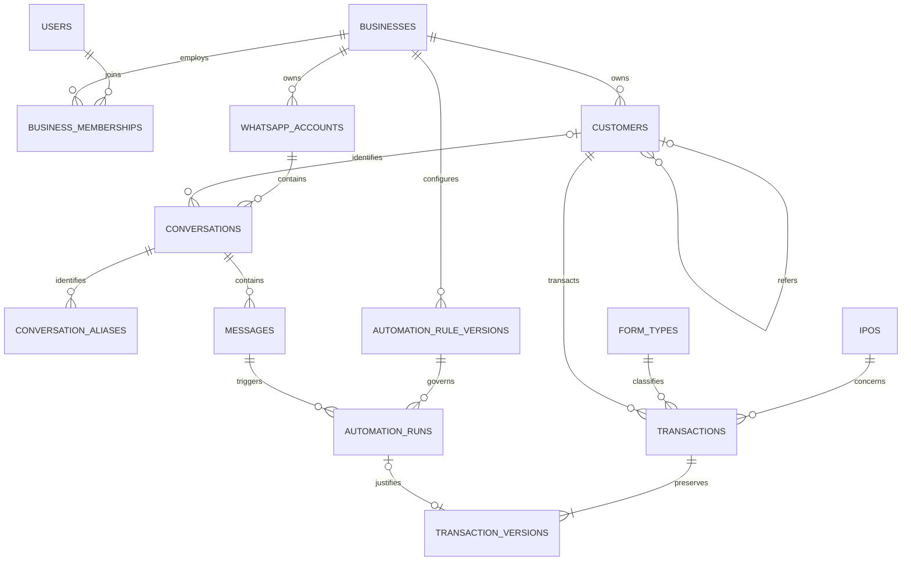

# IPO transaction database design

The executable schema is [database/001_initial.sql](../database/001_initial.sql), extended for authentication and manual request idempotency by [database/002_api.sql](../database/002_api.sql) and indexed account pagination by [database/003_whatsapp_accounts.sql](../database/003_whatsapp_accounts.sql). It targets PostgreSQL 17+ and is tested using synthetic data in a disposable database. The [Go API](../backend/README.md) implements the manual business workflow, account registration and authenticated pairing; message-archive integration remains a subsequent step.

## Agreed rules

- Multiple businesses, each with multiple staff. Roles are admin and cashier.
- Transactions may be entered by staff or confirmed automatically by AI plus business rules.
- Each transaction concerns one IPO, customer, form type, and category.
- Form types initially: Retail, Retail 199, SHNI, BHNI, Shares, CE, PE.
- Category is `none`, `subject_1`, or `subject_2`. Subject calculations belong to future analytics and never enter this transaction's amount calculation.
- CE/PE values such as 20, 40, or 20.5 belong to each transaction and its history. They are required for CE/PE and absent for other types. They are not catalogue combinations or amount multipliers.
- Quantity can be fractional. The only amount calculation is `total_amount = round(rate * quantity, 2)`.
- Both first creation and every edit produce complete immutable version snapshots.
- Linked WhatsApp sessions belong in PostgreSQL, one per linked account. Staff may share an account's connection.
- Only private 1:1 text messages enter the message archive/detection pipeline.

The ledger records both purchases from customers and onward sales using neutral
`transactions` naming. [Migration 008](../database/008_signed_transaction_quantity.sql)
defines direction from the business's perspective through quantity: positive for
Buy, negative for Sell, zero invalid. Settlement/payments, category analytics and
inventory remain unimplemented.
[Migration 009](../database/009_signed_transaction_rate.sql) permits positive,
negative and zero rates. Direction remains determined only by quantity.

## Relationships



## Tables and ownership

All application tables live in `ipo_pos`. Business-owned primary keys and foreign keys include `business_id`, preventing cross-business customer/account/staff references. Users and IPO/form catalogues have global IDs/codes.

| Table | Contents |
|---|---|
| `businesses` | Name, currency, active automation-rule version, lifecycle timestamps. |
| `users` | Staff name, unique international phone number, created/disabled timestamps. Password hashes and sign-in sessions live in separate API tables. |
| `user_credentials` | Bcrypt password hash per user, created by the initial bootstrap or an authenticated admin. |
| `login_sessions` | SHA-256 hash of a random bearer token, user and expiry; raw tokens are never stored. |
| `manual_transaction_requests` | Immutable original normalized request hash, creator, business-scoped idempotency key and transaction link. Replays remain identifiable after edits. |
| `business_memberships` | Business/user association and admin/cashier role. Disable a membership instead of deleting historical actor identities. |
| `ipos` | Unique application code, IPO/issuer name, opening/closing/listing dates, optional price band, structured extra metadata, archive timestamp. Catalogue fields do not participate in transaction arithmetic. |
| `form_types` | Stable codes/display names. No transaction-specific CE/PE numbers and no numbered-combination catalogue. |
| `customers` | Name, optional international phone number, referral customer ID, referral note for non-customer referrers, archive timestamp. Names/phones are not assumed to uniquely identify customers. Self-referral and cross-business referral are blocked. |
| `whatsapp_accounts` | Stable application account ID, business, label/number, current library device JID, who linked it, linkage timestamps. No credential-deletion cascade into business records. |
| `conversations` | One canonical private conversation under a business/account, optionally associated with a known customer. |
| `conversation_aliases` | Normalized PN/LID JIDs mapping to the same account/conversation. Hosted identifiers are normalized before insertion, using the viewer's existing normalization. |
| `messages` | Deduplicated text, incoming/outgoing direction, sender snapshots, provider ID, body revision, provider/ingestion times, live/history source, edit/revocation timestamps. |
| `automation_rule_versions` | Immutable validated configuration, schema version, version number, creator and timestamp. Business activation points to one version or null to disable automation. |
| `automation_runs` | Immutable completed decision: exact text blob, structured input snapshots, extracted fields, per-rule results, reason, model/prompt/rule versions, trigger/revision, stable run/order keys. Rejected/incomplete/error decisions are retained without requiring a transaction. |
| `transactions` | Current transaction state, including IPO/customer/time/type/category/CE-PE value/quantity/rate/amount, staff attribution, origin, current version, status, reason, and optional conversation/AI linkage. |
| `transaction_versions` | Full snapshots of those same fields. Composite primary key is business + transaction ID + version. Initial version is included. |

## Transaction fields

| Field | Type / rule |
|---|---|
| `id` | UUID, stable across all revisions. |
| `idempotency_key` | Stable nonempty business order key; unique within a business and immutable. |
| `ipo_id`, `customer_id` | Required references. |
| `occurred_at` | Actual transaction time, separate from record creation/change times. |
| `form_type_code` | Required catalogue code. |
| `category` | Required: none / subject_1 / subject_2. |
| `ce_pe_value` | `numeric(18,6)`, required only for CE/PE. No multiplication role. |
| `quantity` | Nonzero `numeric(18,6)`: positive for Buy, negative for Sell. |
| `rate` | Signed `numeric(18,6)`; positive, negative and zero are valid. |
| `total_amount` | Database-generated `numeric(30,2)`: rounded rate times signed quantity. Callers cannot supply a different amount. |
| `currency_code` | Business currency snapshot. Initial business default is INR. |
| `salesperson_user_id` | Optional responsible staff attribution, distinct from the person/automation performing an edit. |
| `origin` | manual / automatic; never changes after creation. |
| `created_by_user_id` | Initial manual creator; null for automatic creation. |
| `changed_by_user_id`, `automation_run_id` | Exactly one actor for each version: staff or accepted automation run. |
| `version`, `updated_at`, `change_reason` | Expected next revision, database timestamp, required explanation. |
| `status` | confirmed / cancelled. Cancellation preserves amount and history; current-state analytics must filter status. |

Six decimal places for quantity/rate/CE-PE values and two for amounts are initial precision choices. Inputs beyond six fractional digits are rounded by PostgreSQL. Validate precision in the API before insertion to avoid silently accepting a more precise user entry. `NaN` is rejected. Use decimal arithmetic/decimal strings in Go and client payloads. Do not send these fields through JavaScript or Go binary floats when exact amounts matter.

Example: CE value 20, Subject 1, quantity 2.5, rate 250 produces 625.00 (Buy).
Quantity -2.5 at the same rate produces -625.00 (Sell). Changing CE value to 40 or
category to Subject 2 does not change the amount if quantity/rate stay unchanged.
At rate -250, quantity 2.5 produces -625.00 (Buy), and quantity -2.5 produces
625.00 (Sell). Do not derive direction from the rate or total.

## Version history and concurrency

Database triggers capture version 1 on insertion and one complete snapshot on every successful update. The versions table copies transaction fields, including CE/PE value and the calculated amount. Direct history insertion, history mutation, and transaction deletion are blocked. Cancel rather than delete transactions.

Update with an expected revision:

```sql
UPDATE ipo_pos.transactions
SET quantity = 3.25,
    ce_pe_value = 40.5,
    changed_by_user_id = :authenticated_user_id,
    automation_run_id = NULL,
    version = :expected_version + 1,
    change_reason = :reason
WHERE business_id = :authorized_business_id
  AND id = :transaction_id
  AND version = :expected_version
RETURNING *;
```

The named placeholders above are illustrative; Go/pgx uses positional parameters. If no row returns, report a missing record/version conflict instead of overwriting another user's changes. Current state and its snapshot commit together. Creation identity/origin/creator are immutable; failed changes produce no partial history.

For later snapshots, link the correct new AI run for an automatic change, or clear it and supply the authenticated staff actor for a manual change. A previously consumed run cannot create another version. The initial automatic origin remains automatic after a cashier correction.

Triggers preserve append-only behavior for ordinary application writes, not against a database owner capable of changing DDL. The eventual service role must not own the schema, disable triggers, or have DDL/TRUNCATE privileges. The database service is accessed only by the Go backend.

## Automatic detection contract

1. Persist/deduplicate an eligible private text; import history for context without automatically booking old transactions.
2. Load up to 10 preceding texts and the trigger, plus any earlier order evidence needed. Save exact text/IDs/revisions/directions/timestamps in the input snapshot.
3. Run AI outside an open database transaction. Validate its structured extraction and evaluate server-controlled business rules.
4. Resolve a stable order key. Later messages about the same order must reuse it; a genuine repeat order gets a different key. Consider manual transactions already linked to the conversation. A run key identifies a particular candidate/trigger revision/model/prompt/rules evaluation, not the business order itself.
5. Persist the completed run, including rejected/incomplete/failed results. A message containing several candidates can produce several candidate-specific runs.
6. For accepted results, write a new transaction or an expected next revision within a short transaction. The run must be accepted, belong to the same conversation/order, reference active rules, and use the current non-revoked trigger revision. A run can justify at most one historical version.
7. Commit before notifying web/mobile clients; clients refetch persisted state on reconnect.

The database checks trigger freshness and relational invariants. The worker must also revalidate every context snapshot against message revisions, verify account linkage/automation eligibility, and serialize decision application per conversation. If evidence changed, preserve a stale result and reevaluate. Maintain monotonic `messages.body_revision` when text changes; raw message writes are backend-only.

Exact database uniqueness prevents repeated delivery/job/API writes. It cannot decide whether two separate messages describe the same order. The resolver and business rules must handle that semantic decision, and leave an ambiguous candidate as `needs_information`. Accepted output must be validated against the extraction and rules before writing; a database flag alone does not establish that AI was correct. Rules for editing/cancelling confirmed transactions remain explicit backend policy, and admin-only rule activation is enforced by the API.

## WhatsApp sessions in the same PostgreSQL database

Phone numbers and account details are stored as follows. Phone numbers are text in
international format, including `+` and country code; they are not integer IDs.

| Table | Relevant columns | Identity and purpose |
|---|---|---|
| `ipo_pos.users` | `id`, `name`, `phone_number`, `created_at`, `disabled_at` | Staff phone is globally unique; memberships link the user to businesses. |
| `ipo_pos.customers` | `business_id`, `id`, `name`, `phone_number`, `name_supplied_by_user_id`, `referred_by_customer_id`, `referral_note`, `created_at`, `archived_at` | Primary key `(business_id,id)`; phone is optional and nonunique. |
| `ipo_pos.contact_names` | `business_id`, `phone_number`, `supplied_by_user_id`, `name`, `source`, `received_at`, `updated_at` | Primary key `(business_id,phone_number,supplied_by_user_id)`; preserves each staff member's name for a number. |
| `ipo_pos.whatsapp_number_checks` | `business_id`, `phone_number`, `registered`, `checked_at`, `whatsapp_account_id` | Primary key `(business_id,phone_number)`; one successful registration result per business/number. |
| `ipo_pos.whatsapp_accounts` | `business_id`, `id`, `label`, `phone_number`, `device_jid`, `linked_by_user_id`, `created_at`, `unlinked_at`, `auth_generation` | Primary key `(business_id,id)`; stable application account linked to its staff owner and verified WhatsApp device. |

[Migration 007](../database/007_whatsapp_number_checks.sql) adds the boolean
`whatsapp_number_checks.registered`: true means registered, false means unregistered.
No row means unchecked/unknown. `checked_at` records the database timestamp of the
saved successful result; the business-scoped account foreign key identifies the
connection used. The trusted worker inserts/updates results; the runtime role can
only read them. Successful checks overwrite prior observations, including true to
false; failures retain them. The contact lookup reads these columns by business
and number. Status is not duplicated across customers or contact-name suppliers,
and existing phone numbers are not automatically checked or backfilled.

The account `phone_number` is the sender's number verified during pairing; its
`device_jid` identifies the saved linked-device session. Neither field describes
customer registration. Before pairing both may be null; revocation clears the
device binding, retains the account ID and records `unlinked_at`. A persisted
binding does not prove the connection is currently online. `auth_generation`
invalidates dependent POS sessions when binding identity changes. Partial unique
indexes allow one active linked account per staff user and per sender number.

Actual encryption keys and saved protocol sessions live in the separate
library-managed `whatsapp.*` tables, linked through `device_jid`. They are server
credentials and are never returned with public account details.

Two schemas separate application data from protocol credentials:

```text
Your PostgreSQL database
  ipo_pos.*    -> users, customers, IPOs, transactions, messages, AI decisions
  whatsapp.*   -> library-managed device keys, encryption sessions, contacts, sync state
```

The initial migration reserves `whatsapp`. Do not recreate its credential tables by hand: the library upgrades them through its own migrations. The viewer's `openSessionStore` uses pgx/database/sql, forces every connection's search path to `whatsapp`, checks connection readiness, and calls `sqlstore.NewWithDB(...).Upgrade`. It also creates the namespace if absent. Use another pool using application-qualified SQL for `ipo_pos` when implementing the business API.

The connection configuration comes from the server-only `WHATSAPP_DATABASE_URL` environment variable. The runnable implementation is `examples/login/session.go`; it registers pgx through its stdlib package and does not use SQLite. A minimal equivalent of library initialization is:

```go
// Requires the pgx database/sql driver import:
// _ "github.com/jackc/pgx/v5/stdlib"
container, err := sqlstore.New(ctx, "pgx", os.Getenv("WHATSAPP_DATABASE_URL"), nil)
```

The server-only URL points to the application database. Never put this URL or credential/key data in a frontend bundle. The migration/service roles and TLS settings are configured during deployment. See [the viewer instructions](../examples/login/README.md) for local configuration; connection parse/setup errors avoid logging passwords.

For multiple accounts, create a new device for new pairing and load a specific saved device by the owning account's JID for reconnect. The demo supports `-new-session` and `-session <device-JID>` and refuses ambiguous selection when several accounts exist. Its no-flag convenience only resumes when exactly one account exists. The authenticated API's trusted pairing worker manages sessions through the authorized business/account mapping. Registration accepts only a label and takes the business/user identity from authentication. Runtime INSERT grants cover only `business_id`, `label` and `linked_by_user_id`; protocol binding writes use the trusted worker connection. Pairing/code/connect routes require the registering user's active membership. The worker persists verified identities in the stable account row, clears revoked/missing bindings, restores eligible mappings on restart, and holds a PostgreSQL advisory lock per active account. Eligibility checks run every 15 seconds; a lost database connection stops the client. The standalone viewer does not use those account locks and must not share an active API session. Multiple staff viewing business data reuse the owning account's connection.

The library session tables are necessary; `whatsapp_accounts` alone is not a saved login. Application sign-in sessions are stored separately in `ipo_pos.login_sessions`. The existing `examples/login/session.db` has not been read, deleted, or migrated. PostgreSQL pairing creates a separate linked-device session; the viewer no longer reads SQLite. Use a fresh pairing unless a deliberate credential migration is implemented later.

## Indexes and expansion

The schema indexes business/customer/IPO transaction timelines, conversation message time, phone lookup, and evaluation time. Primary/unique indexes cover identity aliases, retry keys, and version lookups. Use keyset pagination on `(occurred_at, id)` or `(sent_at, id)` rather than large offsets. AI context reads return a bounded window; the archive remains in PostgreSQL.

IPOs/forms have relational fields; validated JSON is reserved for extra IPO metadata and versioned AI/rule payloads. Add future domain fields with explicit migrations. Because snapshot fields mirror the current record, any new transaction field must be added to both tables in the same migration (same column order while the snapshot trigger uses `NEW.*`) and the tests updated. Do not alter historical snapshots to reinterpret older category calculations. Future analytics can join raw versions with separately versioned analytical rules.

Migration [013](../database/013_ipo_catalogue.sql) implements the
[IPO catalogue collection contract](PROJECT_VISION.md#ipo-information). It extends
`ipos` with board/provider identity, dates, lot/registrar/issue terms and provenance.
`ipo_subscriptions`, `ipo_reservations`, `ipo_promoter_shareholdings` and
`ipo_anchor_lockins` retain source observations; `ipo_import_runs` stores durable,
deduplicated refresh attempts. The trusted worker alone writes imported values;
the runtime role can insert manual IPO columns and job schedule times. One Go
calculation supplies category application amounts. See [operation and coverage](IPO_CATALOGUE.md).
User-entered business-shared GMP with attribution/history remains a separate
future migration. The importer preserves IPO IDs, manual products and transaction
references; leaving the active list or a source failing never deletes history.

IPO price metadata is not a transaction rate source unless an explicit later rule says so. No extra units column, numbered-form combinations, inventory tables, payment assumptions, or Subject 1/2 formulas are included.

## Planned dashboard extension

The [dashboard requirements](IPO_POSITION_REPORTING.md) and
[database/API design](IPO_ANALYTICS_DESIGN.md) define the next analytics increment.
Reuse the ledger and its immutable versions; keep transaction quantity-times-rate
amounts unchanged. Proposed additive storage covers business assumption revisions,
frozen source basis, manual share reconciliation/coverage, listing references and
original daily closes, plus versioned share conversion for allotted applications.
These are design documents, not installed tables, migrations or working endpoints.
Payments/collections and post-listing settlement remain outside this scope.

## Validation and application

From the workspace root:

```powershell
./database/Test-Schema.ps1
./database/Test-Schema.ps1 -WithSessionTests
./database/Test-Schema.ps1 -WithSessionTests -WithApiTests
```

The runner uses installed PostgreSQL 17 tools to create an isolated temporary cluster on loopback with a temporary port and synthetic data. It applies migrations 001–013, stops the server and verifies its temporary path before removing the test directory. It does not contact the existing PostgreSQL service. A different PostgreSQL installation can be supplied with `-PostgresBin`; a Go executable outside PATH can be supplied with `-GoExecutable`.

Tests cover decimal calculations, CE/PE requirements, categories, business-scoped references, referrals, duplicate messages/transactions, version snapshots, stale revisions, immutable history, accepted/rejected AI linkage, inactive rules, stale/revoked trigger evidence, and disabled staff. `-WithSessionTests` additionally invokes the actual Go PostgreSQL session-store integration test, verifying two saved device sessions and account-specific contacts across database reopen plus schema placement and explicit account selection. This validates persistence/schema behavior, not AI accuracy, an API implementation, load capacity, or a live WhatsApp pairing/migration.

For a new application database, apply migrations 001–013 once using a migration role. For an existing schema, apply only missing migrations and the runtime column grants documented in `backend/README.md`. Existing schemas are never dropped or reset by the test runner or local setup script. Local setup creates a new database and separate owner/runtime roles; the runtime permissions include the column UPDATE grants required by transaction guard row locks and restricted account registration INSERT grants. `-WithApiTests` checks authenticated manual workflows, account registration and business isolation using that permission model in the disposable cluster.

Technical references: [PostgreSQL constraints](https://www.postgresql.org/docs/17/ddl-constraints.html), [exact numeric types](https://www.postgresql.org/docs/17/datatype-numeric.html), [triggers](https://www.postgresql.org/docs/17/sql-createtrigger.html), [whatsmeow SQL storage](https://pkg.go.dev/go.mau.fi/whatsmeow/store/sqlstore), and [pgx database/sql integration](https://pkg.go.dev/github.com/jackc/pgx/v5/stdlib).
